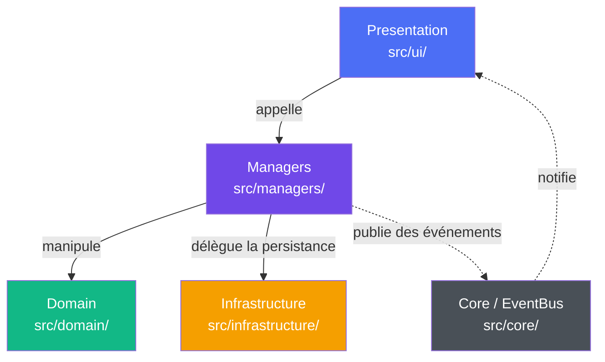

# AI Studio Toolkit


**Application desktop pour orchestrer la production de personnages numériques générés par IA.**

Statut : prototype en développement actif. Le projet suit le Blueprint (`docs/blueprint/`) mission après mission ; chaque mission a une archive détaillée dans [`docs/missions/`](docs/missions/) et une entrée dans [`CHANGELOG.md`](CHANGELOG.md). **Dernier état publié (à la date de cette révision, 2026-10-21) : Mission 182, publiée et close administrativement avec réserves ; validation ciblée examinée ; suite complète non validée.** Un tag de mission atteste une publication, ni la clôture ni la validation complète de la mission. L'état courant, l'architecture et la liste des **réserves ouvertes** sont dans [`docs/PROJECT_CONTEXT.md`](docs/PROJECT_CONTEXT.md). Les exécutions de tests consignées ont eu lieu sous Windows 10 et Python 3.11.9 ; Python 3.10 (annoncé ci-dessous) n'a pas été exécuté et Linux/macOS n'ont pas été vérifiés.

## Sommaire

- [Présentation](#présentation)
- [Pourquoi AI Studio Toolkit ?](#pourquoi-ai-studio-toolkit-)
- [Objectifs](#objectifs)
- [Fonctionnalités actuelles](#fonctionnalités-actuelles)
- [Captures d'écran](#captures-décran)
- [Architecture actuelle](#architecture-actuelle)
- [Architecture](#architecture)
- [Principes de conception](#principes-de-conception)
- [Installation](#installation)
- [Lancement](#lancement)
- [Tests](#tests)
- [Structure du dépôt](#structure-du-dépôt)
- [Historique des missions](#historique-des-missions)
- [Releases](#releases)
- [Licence](#licence)

---

## Présentation

AI Studio Toolkit est une application desktop (PySide6) qui vise à devenir un espace de travail unifié pour la production de contenu IA : création de personnages numériques, entraînement de modèles, gestion de datasets, génération d'images et de vidéos, gestion de prompts et de workflows.

Le logiciel ne remplace pas les moteurs IA existants — il les orchestre. ComfyUI reste responsable de la génération d'images par nodes, OneTrainer de l'entraînement de modèles (backend d'entraînement actuellement supporté ; Kohya_ss est un backend potentiel futur, non engagé), les moteurs cloud (GPT Image 2, Kling, fal.ai, etc.) de la génération distante. AI Studio Toolkit coordonne l'ensemble depuis une interface unique, pour éviter à l'utilisateur de jongler entre des dizaines d'outils séparés pendant une production.

La vision complète du produit est documentée dans [`docs/blueprint/00_VISION.md`](docs/blueprint/00_VISION.md).

## Pourquoi AI Studio Toolkit ?

Produire un personnage numérique avec l'IA aujourd'hui implique de jongler entre de nombreux outils indépendants : un node-editor pour générer des images, un outil séparé pour entraîner un LoRA, un service cloud pour la vidéo, un gestionnaire de fichiers pour organiser les datasets. Chaque outil a sa propre interface, son propre format de fichier, sa propre courbe d'apprentissage — et rien ne relie une génération à son contexte de production une fois l'outil fermé.

AI Studio Toolkit part du principe qu'il ne faut **pas réinventer** ces outils, mais les **orchestrer** : ComfyUI reste responsable de la génération d'images par nodes, OneTrainer de l'entraînement de LoRA (Kohya_ss est un backend potentiel futur, non engagé), les moteurs cloud (GPT Image 2, Kling, fal.ai, Seedance, Seedream, Higgsfield...) de la génération distante. Le rôle du logiciel est de fournir l'espace de travail qui coordonne ces moteurs, organise leurs résultats et fait persister le contexte d'une production — personnages, datasets, historique — d'un bout à l'autre du cycle, plutôt que de le laisser éclaté entre dix applications.

## Objectifs

- Offrir un espace de travail unique couvrant tout le cycle de production : création → datasets → entraînement → génération → publication → archivage.
- Garder chaque sous-système indépendant et remplaçable (modularité), pour ajouter ou retirer une fonctionnalité sans casser le reste.
- Traiter chaque moteur IA (local ou cloud) comme un plugin interchangeable, jamais comme une dépendance en dur du cœur applicatif.
- Ne jamais modifier les données de l'utilisateur de façon destructrice ou irréversible.

Le détail des exigences fonctionnelles se trouve dans [`docs/blueprint/01_PRODUCT_REQUIREMENTS.md`](docs/blueprint/01_PRODUCT_REQUIREMENTS.md).

## Fonctionnalités actuelles

Cette section est une **synthèse issue de l'historique des missions** (titres et récits de [`docs/missions/`](docs/missions/), détail dans [`CHANGELOG.md`](CHANGELOG.md)) ; elle n'est pas une nouvelle vérification de chaque comportement. Les preuves de chaque point (tests automatisés, smoke tests réels) et leurs limites sont consignées dans l'archive de la mission citée. La suite complète de tests n'est pas validée, et les réserves ouvertes sont dans [`docs/PROJECT_CONTEXT.md`](docs/PROJECT_CONTEXT.md). Ce qui est décrit par les missions :

- **Workspace et projets** — création directe d'un dossier de projet, ouverture et sauvegarde d'un projet (`project.json`), renommage du projet avec remappage des chemins internes, refus explicite des fichiers de stockage inutilisables (Missions 016, 027, 140, 166, 178, 179).
- **Personnage** — un projet correspond à un personnage principal avec une fiche d'identité (bio, description, verrou de cohérence, personnalité, centres d'intérêt, jeton déclencheur) (Missions 026, 036).
- **Images** — import par copie dans le workspace avec gestion des collisions de noms, galerie à miniatures, aperçu agrandi, suppression, tri par nom, par date ou par « Ordre d'ajout » (défaut : derniers ajouts d'abord, Mission 180) (Missions 015, 019, 028, 046, 048, 049, 180).
- **Datasets** — création, sélection, renommage et suppression au sein du personnage, import d'images propre à chaque dataset, ajout depuis la galerie Images (le sélecteur présente aussi les derniers ajouts d'abord depuis la Mission 182), retrait d'images, captions par image, protection des brouillons (Missions 003, 042, 044, 045, 054, 098, 158 à 160, 165, 182).
- **LoRA** — LoRA du personnage avec fichiers et fiche de métadonnées ; Bibliothèque LoRA centrale (registre, import, consultation, édition, miniature) ; exposition à ComfyUI et à Forge par lien physique NTFS, donc propre à Windows (Missions 004, 047, 050, 087 à 095).
- **Prompts et assistant IA** — création, édition et renommage de prompts ; assistant de prompt via Ollama dans les pages Inference et Prompts, avec le contexte du personnage ; transfert Prompts → Inference (Missions 005, 030 à 035, 039 à 041, 053, 177).
- **Models et Workflows** — création, sélection, renommage et suppression au sein du workspace, avec association d'un fichier externe : le fichier est référencé, l'application ne l'analyse pas et ne l'exécute pas (Missions 006, 007, 052).
- **Training** — définition d'un entraînement rattaché à un dataset, génération de la configuration OneTrainer et matérialisation du dataset, exécution d'un entraînement par OneTrainer (processus suivi par l'application, annulation), réglages de base et avancés, import du résultat dans la Bibliothèque LoRA ; OneTrainer est le seul backend d'entraînement supporté (Missions 008, 097, 100, 103, 120 à 132). Un smoke test réel consigné par la Mission 101 porte sur une configuration locale précise (voir `docs/missions/MISSION_101.md`).
- **Inference** — génération d'images par ComfyUI (texte vers image, image vers image avec image de référence et réglage de force) et par Forge, sélection de checkpoint et de LoRA, paramètres de génération, validation Accept/Reject/Regenerate avant enregistrement, démarrage et arrêt locaux des moteurs, provenance des générations (Missions 013, 014, 021 à 025, 059, 096, 102, 107, 108, 114 à 117, 119, 123).
- **Réglages** — réglages de Workspace (`theme`, `language`, enregistrés dans `project.json`) et réglages d'application (chemins, URL et paramètres des moteurs, dans `%LOCALAPPDATA%\AIStudioToolkit\application_settings.json` sous Windows, hors `project.json`). Les valeurs de thème et de langue sont enregistrées ; une recherche textuelle dans `src/ui` n'y trouve aucune application à l'interface (constat lexical, qui ne prouve pas l'absence) (Missions 009, 010, 018, 055, 118, 144, 154).
- **Dashboard et navigation** — compteurs et actions de création, d'ouverture et d'import ; navigation par sidebar en 11 sections : Dashboard, Characters, Images, Datasets, Models, Workflows, LoRA, Prompts, Training, Inference, Settings (Missions 017, 043).
- **Robustesse** — retour arrière des mutations lorsque la sauvegarde échoue, protection des brouillons non sauvegardés à la navigation, au changement de contexte et à la fermeture (Missions 038, 066 à 079, 083, 084, 105, 163, 171, 172).

**Limites à connaître.** Suite complète de tests non validée ; validations consignées sous Windows 10 et Python 3.11.9 seulement ; effet à l'écran des Missions 180 et 182 non observé ; ordre rendu par les sélecteurs de fichiers et par `selectedItems()` sous interaction réelle non vérifié. Les fonctionnalités des moteurs externes (génération, entraînement) dépendent de leur installation locale et ne sont pas garanties par ce document.

## Captures d'écran

Aucune capture pour l'instant — l'interface évolue encore rapidement pendant la phase de fondations architecturales. Emplacements réservés pour les prochaines captures, dans `docs/images/` :

- `docs/images/dashboard.png` — Vue Dashboard
- `docs/images/images-page.png` — Page Images
- `docs/images/main-window.png` — Fenêtre principale

## Architecture actuelle

> **Récit daté.** Cette section raconte l'introduction des entités du Domain aux **Missions 001 à 010** ; elle n'est pas l'état courant du projet. L'état courant et l'architecture à jour sont dans [`docs/PROJECT_CONTEXT.md`](docs/PROJECT_CONTEXT.md).

Le projet en est à l'étape **Blueprint 02** ([`docs/blueprint/02_ARCHITECTURE.md`](docs/blueprint/02_ARCHITECTURE.md)) : la Mission 001 a posé les fondations architecturales — couches Presentation / Managers / Domain / Infrastructure / Core, `EventBus`, source unique de vérité — sans introduire de nouvelle fonctionnalité IA. La Mission 002 a introduit `Character`, la première entité du Domain Model au-delà de `Workspace`, avec un périmètre volontairement minimal. La Mission 003 a introduit `Dataset`, deuxième entité de la hiérarchie `Character → Datasets` — cette fois avec une différence assumée : `Dataset.images` est fonctionnel dès son introduction, plutôt que de rester une coquille vide en attendant une mission de migration ultérieure.

La Mission 004 a introduit `LoRA`, troisième entité de cette hiérarchie (`Character → LoRAs`), avec `LoRA.files` fonctionnel dès son introduction comme `Dataset.images`, et un Domain volontairement plus riche que celui de `Dataset` dès sa conception (fichiers techniques, aperçu, métadonnées descriptives).

La Mission 005 a introduit `Prompt`, quatrième entité de cette hiérarchie (`Character → Prompt Library`), avec un retour délibéré au minimalisme de `Dataset` après l'exception `LoRA` — les catégories de prompts prévues par le Blueprint sont explicitement différées jusqu'à l'existence d'un consommateur réel.

La Mission 006 a introduit `Model`, cinquième entité du Domain Model et la première rattachée exclusivement au `Workspace` plutôt qu'au `Character` — démontré par huit citations Blueprint indépendantes. Premier Manager du projet sans dépendance à `CharacterManager`.

La Mission 007 a introduit `Workflow`, sixième entité du Domain Model et deuxième ressource Workspace-owned après `Model` (`Workspace.workflows`). Domain minimal (`workflow_id`, `name`, `file_path`) permettant d'associer un fichier externe (`.json`), sans parsing ni exécution de son contenu. Voir le CHANGELOG pour le détail des décisions de conception de cette mission.

La Mission 008 introduit `Training` comme nouvelle entité Domain Character-owned. Elle rejoint `Dataset`, `LoRA` et `Prompt` parmi les entités possédées par `Character` (`Character.trainings: list[Training]`). L'ownership retenu s'appuie sur `04_DOMAIN_MODEL.md` §4, qui place explicitement `Trainings` sous `Characters` dans la hiérarchie d'entités ; les arbres structurels de `00_VISION.md`, `01_PRODUCT_REQUIREMENTS.md` et `02_ARCHITECTURE.md` ne nomment à cet emplacement que `Training History` — un concept distinct, non implémenté par cette mission — jamais `Training` elle-même. Cette divergence documentaire est signalée, non résolue. Mission 008 introduit également la première intégrité référentielle inter-entités du projet : un Dataset du personnage actif référencé par au moins un Training ne peut pas être supprimé tant que cette référence existe, sans suppression en cascade. Voir le CHANGELOG pour le détail des décisions de conception de cette mission.

La Mission 009 introduit `Settings` comme entité Domain Workspace-owned sous forme de singleton `Workspace.settings: Settings`, et non comme une collection. Le Domain minimal contient `theme` et `language`. `SettingsManager` fournit un accès direct au singleton et une mise à jour idempotente ; aucun identifiant, aucune sélection et aucun événement Settings dédié ne sont nécessaires. Les valeurs historiques absentes, nulles ou mal typées sont normalisées défensivement vers `Settings()` lors du chargement ; les clés inconnues ne sont pas conservées. Voir le CHANGELOG pour le détail des décisions de conception de cette mission.

La Mission 010 introduit `ApplicationSettings`, objet Domain Application-level persisté indépendamment de `project.json` dans un stockage local dédié (`ApplicationSettingsStorage`, `%LOCALAPPDATA%\AIStudioToolkit\application_settings.json` sous Windows, avec repli déterministe si `LOCALAPPDATA` est absent). Écriture atomique (fichier temporaire + `os.replace()`) : le dernier fichier valide est toujours conservé si une sauvegarde échoue. `ApplicationSettingsManager` applique une stratégie "candidat d'abord" — le nouvel état est construit et persisté avec succès *avant* tout remplacement de l'état mémoire, garantissant qu'un échec de sauvegarde ne laisse jamais la mémoire dans un état non confirmé par le disque. Événement dédié `application_settings.updated`, publié uniquement après une sauvegarde réussie. `SettingsPage` intègre désormais deux sections strictement indépendantes — Workspace Settings et Application Settings — chacune avec son propre bouton de sauvegarde et son propre canal de rafraîchissement ; aucune n'affecte l'autre. Voir le CHANGELOG pour le détail des décisions de conception de cette mission.

Les fonctionnalités décrites dans la Vision et les Exigences produit (génération d'images et de vidéos, entraînement de LoRA, moteurs, plugins, personnages numériques...) seront introduites progressivement, mission après mission, chacune s'appuyant sur ces fondations plutôt que sur des raccourcis. Voir [Historique des missions](#historique-des-missions) ci-dessous.

## Architecture

L'application suit une architecture en couches définie dans [`docs/blueprint/02_ARCHITECTURE.md`](docs/blueprint/02_ARCHITECTURE.md), où les dépendances ne circulent que vers le bas :



- **Presentation** (`src/ui/`) — fenêtre principale, pages, widgets. Affiche l'information et collecte les entrées utilisateur ; ne lit jamais un fichier ni n'appelle une API directement.
- **Managers** (`src/managers/`) — ex. `WorkspaceManager`, `CharacterManager`, `DatasetManager`, `LoRAManager`, `PromptManager`, `ModelManager`, `WorkflowManager`, `TrainingManager`, `SettingsManager`, `ApplicationSettingsManager`, sources uniques de vérité pour l'état du workspace, des personnages, des datasets, des LoRA, des prompts, des modèles, des workflows, des sessions d'entraînement, des préférences de Workspace et des préférences Application. Coordonnent les opérations, ne manipulent jamais de widgets. `SettingsManager` et `ApplicationSettingsManager` dérogent tous deux au pattern CRUD partagé par les autres : singletons, pas de collection, pas de `create`/`select`/`delete` — mais `ApplicationSettingsManager` est seul à posséder son propre stockage physique, entièrement indépendant de `WorkspaceManager`.
- **Domain** (`src/domain/`) — ex. `Workspace`, `Character`, `Dataset`, `LoRA`, `Prompt`, `Model`, `Workflow`, `Training`, `Settings`, `ApplicationSettings`, objets métier sérialisables, indépendants de Qt et du stockage.
- **Infrastructure** (`src/infrastructure/`) — ex. `WorkspaceStorage`, persistance JSON, gestion d'erreurs typées. Ne connaît pas le Domain : elle échange des dictionnaires, pas des objets métier.
- **Core** (`src/core/`) — ex. `EventBus`, mécanisme pub/sub découplé (sans Qt) permettant à la Presentation de réagir aux changements d'état sans lien direct avec les Managers.

Cette architecture est le résultat de la **Mission 001** (voir [`CHANGELOG.md`](CHANGELOG.md)) : le prototype initial gérait son état de façon ad hoc directement dans l'UI ; il a été refactoré pour se conformer strictement à ce schéma de dépendances, sans changement de fonctionnalité. La **Mission 002** a étendu ce schéma à `Character` en respectant les mêmes règles dès son introduction, plutôt que de les rattraper après coup. La **Mission 003** a fait de même pour `Dataset`, et a corrigé en ouverture de mission une dette identifiée lors d'un audit dédié : `MainWindow` importait une exception directement depuis l'Infrastructure, contournant les Managers. La **Mission 004** a fait de même pour `LoRA`, corrigeant également en ouverture de mission une dette identifiée lors de son propre audit : la carte Dashboard "Datasets" lisait un champ vestigial au lieu d'agréger les données réelles. La **Mission 005** a fait de même pour `Prompt`, corrigeant elle aussi en ouverture de mission le même type de dette sur la carte Dashboard "LoRA". La **Mission 006** a fait de même pour `Model`, sans dette à corriger en ouverture cette fois. Un examen a posteriori (audit Mission 007) a confirmé que la carte Dashboard "Models" n'avait en réalité besoin d'aucun correctif : sa lecture de `Workspace.models` était déjà correcte, elle affiche désormais les données réelles automatiquement. La **Mission 007** a fait de même pour `Workflow`, deuxième ressource Workspace-owned, sans dette de code à corriger en ouverture. La **Mission 008** a fait de même pour `Training`, qui rejoint `Dataset`, `LoRA` et `Prompt` parmi les entités Character-owned, sans dette de code à corriger en ouverture. La **Mission 009** a fait de même pour `Settings`, entité Domain Workspace-owned prenant la forme d'un singleton plutôt que d'une collection. La **Mission 010** a introduit `ApplicationSettings`, objet Domain Application-level persisté indépendamment de `project.json` dans un stockage local dédié.

## Principes de conception

Ces règles, définies dans [`docs/blueprint/02_ARCHITECTURE.md`](docs/blueprint/02_ARCHITECTURE.md), s'appliquent à tout nouveau code, sans exception :

- **Single Source of Truth** — un seul objet représente l'état réel à un instant donné (ex. `WorkspaceManager.current_workspace`) ; jamais de duplication d'état entre l'UI et les Managers.
- **Dependency Rule** — les dépendances ne remontent jamais : `Presentation → Managers → Domain → Infrastructure`, jamais l'inverse.
- **Event Driven UI** — les pages ne se rafraîchissent jamais par appel direct entre elles ; elles s'abonnent aux événements publiés par l'`EventBus`.
- **Domain indépendant de Qt** — les objets métier (`Workspace`, ...) n'importent jamais PySide6 et restent testables sans interface graphique.
- **Infrastructure ignorant le Domain** — la couche de stockage échange des dictionnaires, jamais des objets métier ; la conversion est la responsabilité des Managers.
- **Managers sans widgets Qt** — les Managers coordonnent l'état applicatif mais ne créent, ne lisent ni ne modifient jamais un widget directement.

## Installation

Prérequis : Python 3.10+ recommandé.

```bash
git clone <url-du-dépôt>
cd AI-Studio-Toolkit
python -m venv .venv
.venv\Scripts\activate          # Windows
pip install -r requirements.txt
```

## Lancement

Depuis la racine du dépôt :

```bash
python -m src.core.main
```

## Tests

Tests d'intégration en `unittest` de la bibliothèque standard (aucun framework externe) dans `tests/integration/` : 66 modules `test_*.py`. Depuis la racine du dépôt, avec l'environnement virtuel du projet :

```bash
# Un module (exemple)
python -m unittest tests.integration.test_workspace_roundtrip -v

# Découverte canonique de tous les modules
python -m unittest discover -s tests -p "test_*.py"
```

**Limites.** La suite complète n'est **pas validée** à ce jour : la dernière suite complète dont tous les tests ont réussi (Mission 176) a une supervision incomplète, une tentative ultérieure s'est terminée par un arrêt anormal du processus de test (Mission 177, non résolu), et la campagne partitionnée de la Mission 181 est incomplète (un lot de 141 tests, `test_forge_lifecycle_manager`, n'a pas été exécuté). Ne lancez pas ce lot sans lire [`docs/PROJECT_CONTEXT.md`](docs/PROJECT_CONTEXT.md). Le fichier `tests/integration/isolated_test_onetrainer_cancel_helper.py` est volontairement hors de la découverte canonique et s'exécute à part. Plusieurs modules construisent de vraies fenêtres Qt ; certains lancent de vrais processus enfants.

## Structure du dépôt

Arborescence des fichiers suivis par Git (relevée sur le dépôt ; les fichiers `__init__.py` et les dossiers locaux non suivis ne sont pas listés) :

```
AI-Studio-Toolkit/
├── .claude/                    # Configuration de l'assistant de développement (hors application)
├── docs/
│   ├── blueprint/              # 5 documents de référence architecturale (source de vérité)
│   ├── missions/               # Une archive détaillée par mission (MISSION_NNN.md)
│   ├── archive/                # Contenus retirés de la documentation courante, conservés à l'identique
│   ├── images/                 # Captures d'écran (à venir)
│   └── PROJECT_CONTEXT.md      # État courant du projet et réserves ouvertes
├── graphify-out/               # Graphe de connaissance généré (non édité à la main)
├── src/
│   ├── core/                   # EventBus, point d'entrée, configuration, journalisation
│   │   ├── config.py
│   │   ├── event_bus.py
│   │   ├── logger.py
│   │   └── main.py
│   ├── domain/                 # Objets métier, indépendants de Qt
│   │   ├── application_settings.py
│   │   ├── character.py
│   │   ├── dataset.py
│   │   ├── generation_metadata.py
│   │   ├── image.py
│   │   ├── lora.py
│   │   ├── model.py
│   │   ├── onetrainer_optimizer_settings.py
│   │   ├── onetrainer_settings.py
│   │   ├── prompt.py
│   │   ├── settings.py
│   │   ├── training.py
│   │   ├── training_job.py
│   │   ├── workflow.py
│   │   └── workspace.py
│   ├── infrastructure/         # Persistance (dictionnaires, jamais d'objets métier)
│   │   └── storage/
│   │       ├── application_settings_storage.py
│   │       ├── lora_library_storage.py
│   │       └── workspace_storage.py
│   ├── managers/               # Coordination applicative (sans widgets Qt)
│   │   ├── application_settings_manager.py
│   │   ├── character_manager.py
│   │   ├── dataset_manager.py
│   │   ├── generation_manager.py
│   │   ├── lora_library_manager.py
│   │   ├── lora_manager.py
│   │   ├── model_manager.py
│   │   ├── prompt_assistant_manager.py
│   │   ├── prompt_manager.py
│   │   ├── settings_manager.py
│   │   ├── training_manager.py
│   │   ├── workflow_manager.py
│   │   ├── workspace_lifecycle.py
│   │   └── workspace_manager.py
│   ├── engines/                # Clients des moteurs externes (ComfyUI, Forge, Ollama) et configuration OneTrainer
│   │   ├── ai_backend.py
│   │   ├── comfyui_engine.py
│   │   ├── comfyui_install.py
│   │   ├── comfyui_launch.py
│   │   ├── diagnostic_errors.py
│   │   ├── forge_engine.py
│   │   ├── forge_install.py
│   │   ├── forge_launch.py
│   │   ├── ollama_engine.py
│   │   ├── onetrainer_cancel_helper.py
│   │   ├── onetrainer_config.py
│   │   ├── onetrainer_launch.py
│   │   └── workflows/          # comfyui_workflows.py
│   ├── ui/                     # Fenêtre principale, pages, dialogues, workers
│   │   ├── comfyui_lifecycle_manager.py
│   │   ├── comfyui_readiness_worker.py
│   │   ├── forge_lifecycle_manager.py
│   │   ├── forge_readiness_worker.py
│   │   ├── generation_worker.py
│   │   ├── main_window.py
│   │   ├── menubar.py
│   │   ├── prompt_assistant_worker.py
│   │   ├── sidebar.py
│   │   ├── statusbar.py
│   │   ├── thumbnails.py
│   │   ├── toolbar.py
│   │   ├── training_job_runner.py
│   │   ├── pages/              # characters_page, dashboard_page, datasets_page, images_page, inference_page, lora_page, models_page, prompts_page, settings_page, training_page, workflows_page
│   │   └── dialogs/            # image_preview_dialog, import_collision_dialog, new_project_dialog, prompt_assistant_dialog, rename_project_dialog, select_images_dialog
│   ├── utils/                  # base_model_source.py, lora_library_path.py
│   ├── resources/              # Ressources embarquées — ne contient que __init__.py
│   └── services/               # Opérations métier réutilisables — ne contient que __init__.py
├── tests/
│   └── integration/            # 66 modules test_*.py, modules d'appui (_fake_*, _qt_dialog_safety_net) et un fichier isolé
├── AGENTS.md                   # Consignes pour les agents de développement
├── CHANGELOG.md                # Journal des missions
├── CLAUDE.md                   # Règles permanentes du projet
├── README.md
├── pyproject.toml
└── requirements.txt
```

## Historique des missions

L'historique détaillé de **toutes** les missions se trouve dans [`CHANGELOG.md`](CHANGELOG.md) (une entrée par mission) et dans [`docs/missions/`](docs/missions/) (une archive par mission). Le tableau ci-dessous reprend, tel qu'il a été rédigé, le détail des Missions 001 à 010.

| Mission | Statut | Contenu |
|---|---|---|
| Mission 001 | ✅ Terminée (`v0.2-mission001`) | Refactoring Blueprint 02 : couches Presentation / Managers / Domain / Infrastructure / Core, `EventBus`, tests d'intégration |
| Mission 002 | ✅ Terminée (`v0.2-mission002`) | Introduction du domaine `Character`, entité centrale du Blueprint : CRUD, sélection, persistance, page dédiée |
| Mission 003 | ✅ Terminée (`v0.2-mission003`) | Introduction du domaine `Dataset` : CRUD, sélection, import d'images fonctionnel dès cette mission (déduplication, ordre préservé) |
| Mission 004 | ✅ Terminée (`v0.2-mission004`) | Introduction du domaine `LoRA` : CRUD, sélection, import de fichiers fonctionnel dès cette mission (déduplication, ordre préservé) ; Domain volontairement étendu (8 champs) au-delà du minimalisme appliqué à `Character`/`Dataset` |
| Mission 005 | ✅ Terminée (`v0.2-mission005`) | Introduction du domaine `Prompt` : CRUD, sélection, édition de texte (`update_text()`, idempotent) ; Domain volontairement minimal (3 champs), catégories différées ; correctif Dashboard "LoRA" traité en ouverture |
| Mission 006 | ✅ Terminée (`v0.2-mission006`) | Introduction du domaine `Model` : CRUD, sélection, association de fichier (`update_file_path()`, idempotent) ; première ressource Workspace-owned, premier Manager sans dépendance à `CharacterManager` ; carte Dashboard "Models" déjà correcte sans correctif nécessaire (confirmé lors de l'audit Mission 007) |
| Mission 007 | ✅ Terminée (`v0.2-mission007`) | Introduction du domaine `Workflow` : CRUD, sélection, association de fichier externe (`update_file_path()`, idempotent) ; deuxième ressource Workspace-owned après `Model` ; Domain minimal, aucune fonctionnalité d'exécution |
| Mission 008 | ✅ Terminée (`v0.2-mission008`) | Introduction du domaine `Training` : CRUD (création, sélection, suppression) de sessions d'entraînement au sein du personnage actif, sélection du Dataset source ; nouvelle entité Character-owned aux côtés de `Dataset`/`LoRA`/`Prompt` ; première intégrité référentielle inter-entités du projet (Dataset → Training) ; aucune exécution d'entraînement |
| Mission 009 | ✅ Terminée (`v0.2-mission009`) | Introduction du domaine `Settings` (Workspace) : singleton `Workspace.settings` (`theme`, `language`), `SettingsManager` sans collection ni sélection, `SettingsPage` réelle avec sauvegarde explicite ; retrait des anciens champs machine-locale, actés comme relevant d'une future Application Settings ; aucun événement dédié |
| Mission 010 | ✅ Terminée (`v0.2-mission010`) | Introduction du domaine `ApplicationSettings` (Application-level, hors `project.json`) : `python_path`, `comfyui_path`, `onetrainer_path`, stockage local dédié (`ApplicationSettingsStorage`, écriture atomique), `ApplicationSettingsManager`, intégration dans `SettingsPage` en section indépendante de Workspace Settings ; aucune validation de chemin, aucun lancement d'outil |

Les Missions 011 et suivantes ne sont pas détaillées dans ce fichier. Les tags `v0.2-mission011` et suivants existent dans le dépôt (sauf `v0.2-mission138`), mais **l'existence d'un tag n'atteste ni la clôture ni la validation de la mission** : le statut de chaque mission est dans son entrée du journal et dans son archive. Dernier état publié et réserves ouvertes : voir [`docs/PROJECT_CONTEXT.md`](docs/PROJECT_CONTEXT.md) (à la date de cette révision : Mission 182, publiée et close administrativement avec réserves, suite complète non validée). Ce fichier ne tient plus de feuille de route prospective ; les intentions autrefois listées ici comme « planifiées » ont été retirées et leur texte d'origine est conservé dans [`docs/archive/readme/README_roadmap_avant_consolidation.md`](docs/archive/readme/README_roadmap_avant_consolidation.md). Constat sur le dépôt : `src/engines/` existe, `src/services/` ne contient que `__init__.py` et `src/plugins/` n'existe pas.

Amélioration UX ponctuelle identifiée en cours de route, hors périmètre des missions d'architecture : création du dossier cible directement depuis le dialogue "Nouveau projet", sans devoir le créer manuellement au préalable dans l'explorateur Windows.

## Releases

- **[`v0.2-mission010`](CHANGELOG.md)** — introduction du domaine `ApplicationSettings`, Application-level, hors `project.json` (`python_path`, `comfyui_path`, `onetrainer_path`), stockage local dédié avec écriture atomique. Détail complet dans [`CHANGELOG.md`](CHANGELOG.md).
- **[`v0.2-mission009`](CHANGELOG.md)** — introduction du domaine `Settings`, singleton Workspace-owned (`theme`, `language`), `SettingsManager`, `SettingsPage` réelle. Détail complet dans [`CHANGELOG.md`](CHANGELOG.md).
- **[`v0.2-mission008`](CHANGELOG.md)** — introduction du domaine `Training`, nouvelle entité Character-owned (CRUD de sessions, sélection du Dataset source, intégrité référentielle Dataset → Training). Détail complet dans [`CHANGELOG.md`](CHANGELOG.md).
- **[`v0.2-mission007`](CHANGELOG.md)** — introduction du domaine `Workflow`, deuxième ressource Workspace-owned (CRUD, sélection, association de fichier externe). Détail complet dans [`CHANGELOG.md`](CHANGELOG.md).
- **[`v0.2-mission006`](CHANGELOG.md)** — introduction du domaine `Model`, première ressource Workspace-owned (CRUD, sélection, association de fichier). Détail complet dans [`CHANGELOG.md`](CHANGELOG.md).
- **[`v0.2-mission005`](CHANGELOG.md)** — introduction du domaine `Prompt` (CRUD, sélection, édition de texte idempotente, Domain minimal). Détail complet dans [`CHANGELOG.md`](CHANGELOG.md).
- **[`v0.2-mission004`](CHANGELOG.md)** — introduction du domaine `LoRA` (CRUD, sélection, import de fichiers fonctionnel, Domain étendu). Détail complet dans [`CHANGELOG.md`](CHANGELOG.md).
- **[`v0.2-mission003`](CHANGELOG.md)** — introduction du domaine `Dataset` (CRUD, sélection, import d'images fonctionnel). Détail complet dans [`CHANGELOG.md`](CHANGELOG.md).
- **[`v0.2-mission002`](CHANGELOG.md)** — introduction du domaine `Character` (CRUD, sélection, persistance). Détail complet dans [`CHANGELOG.md`](CHANGELOG.md).
- **[`v0.2-mission001`](CHANGELOG.md)** — première release conforme au Blueprint 02, résultat de la Mission 001. Détail complet des changements dans [`CHANGELOG.md`](CHANGELOG.md).

Les releases suivantes ne sont plus recopiées ici : les Releases GitHub publiées sont consultables sur la page Releases du dépôt, et chaque mission est décrite dans [`CHANGELOG.md`](CHANGELOG.md) et [`docs/missions/`](docs/missions/).

## Licence

MIT — en attendant une décision définitive sur la licence du projet.
